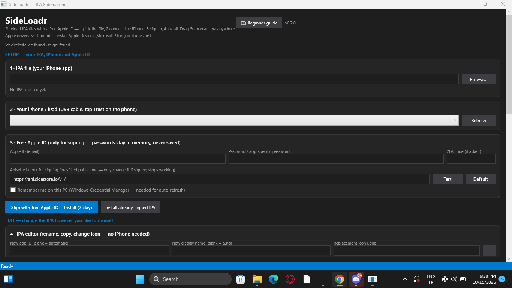
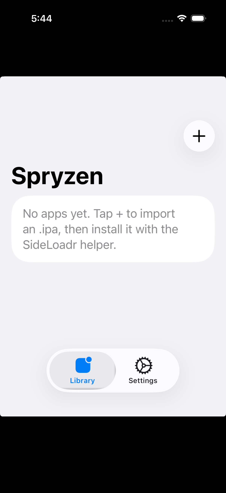

# SideLoadr + Spryzen — sideload IPA files with a free Apple ID

**New here? Pick your path (2 minutes):**

- 🖥️ **Windows user — get the PC app:** go to **Releases**,
  download `SideLoadr-vX-win-x64.exe` (or the `.zip` if your browser blocks it),
  double-click to run. No install needed. On first start it checks for helper
  tools and offers the Beginner guide. Details below under "Install from GitHub".
- 📱 **iPhone user — get Spryzen:** go to **Releases → "Spryzen for iPhone
  (unsigned)"**, download the IPA, then sign + install it with the PC app
  (drag it in, Apple ID, big blue button). Afterwards Spryzen manages your apps
  on-device; point it at the PC helper (`http://PC-IP:8765`, started in Extras).
- 🛠️ **Developer:** `src/` (WPF, .NET 8), `spryzen-ios/` (SwiftUI, XcodeGen),
  `tests/` (40+ checks). Every Mac CI run uploads a fresh unsigned Spryzen IPA.

Free Apple ID rules (Apple's, for everyone): ~3 apps, ~10 IDs, **7-day
certificates** — re-sign to renew. SideLoadr tracks expiry and can auto-renew daily.

Got a **paid Apple ID**? Card 8 signs with your own `.p12` + `.mobileprovision`
instead — no Apple login, longer-lived certificates. The `.p12` is read with
built-in crypto (OpenSSL fallback); temp files are wiped after.

## Screenshots

| SideLoadr (Windows) | Spryzen (iPhone) |
|---|---|
|  |  |

---

WPF desktop app (.NET 8) that signs IPAs with a **free Apple ID** (7-day certificate,
like AltStore/Sideloadly) and installs them on a connected iPhone/iPad over USB.

## Install from GitHub (no setup program — just run it)
1. Go to **Releases** and download `SideLoadr-vX-win-x64.exe` from **Assets**
   (not the "Source code" zip — that is for developers).
   A `.zip` with the same exe is attached too if your browser blocks the raw exe.
2. Double-click the exe. If Windows SmartScreen says it protected your PC,
   click **More info → Run anyway** (the app is unsigned, so Windows asks once).
3. On first start it checks for the helper tools and offers the Beginner guide
   if anything is missing.

## What works today

- **IPA inspection** — drag & drop an `.ipa`, reads bundle ID / name / version /
  minimum iOS from `Info.plist` (XML + binary plists, no dependencies). Verified by tests.
- **Device detection** — UDIDs via libimobiledevice tools when present, otherwise
  Apple USB entries via WMI; checks the Apple Mobile Device Service driver state.
- **Install** — installs an already-signed IPA via `ideviceinstaller`.
- **Free Apple ID signing pipeline** — Apple ID login (with 2FA prompt), App ID +
  device registration, CSR → development certificate, 7-day provisioning profile,
  resign via `zsign`. Implemented end-to-end in code.
- **7-day tracker** — every install is recorded in `%AppData%\SideLoadr\apps.json`
  with expiry date; the app warns when an app has ≤2 days left so you can re-sign.
- Passwords stay in memory only — only the Apple ID email + anisette URL are saved.

## Prerequisites (all on the PC)

1. **Apple drivers** — install *Apple Devices* from the Microsoft Store (or iTunes).
   Connect the iPhone via USB and tap **Trust**.
2. **libimobiledevice Windows binaries** — `idevice_id.exe`, `ideviceinstaller.exe`.
   Drop them in `tools\` next to `SideLoadr.exe` (or on PATH).
3. **zsign Windows build** — `zsign.exe` in `tools\` (or on PATH). Needed for signing.
4. **Anisette server URL** — free signing needs anisette provisioning data, which can
   only be generated with Apple hardware (a Mac, or a self-hosted anisette server).
   Pre-filled default: `https://ani.sidestore.io/v1/` (public server run by the
   SideStore team — I could not verify it from this environment, so replace it if
   it fails; the log shows exactly what the server returned). The client tries
   `{base}/anisette` then `{base}` automatically.

## Spryzen (iOS companion, SideStore-style)

`spryzen-ios/` holds the full SwiftUI source for **Spryzen**, the on-device
companion: library, IPA import, Apple ID login, 7-day tracking, background
refresh. **An `.ipa` can only be compiled on a Mac with Xcode** — see
`spryzen-ios/README.md` for the one-command build (`xcodegen generate` + open in
Xcode). First install is always over USB from this PC app.

Planned (protocol defined, not implemented): Spryzen drives refreshes via
`POST {helper}/refresh` / `POST {helper}/install` against a reachable helper.
SideLoadr does not serve those endpoints yet.

Free-account limits (Apple's, not ours): ~10 App IDs, 3 apps installed at once,
certificates last **7 days**, then re-sign + reinstall.

## Honest status of the free-signing flow

The full pipeline is implemented, but the Apple ID login + Developer Portal calls
mirror private Apple endpoints and **could not be validated here** (no spare Apple ID
/ iPhone / anisette server in this environment). Expect to debug server responses on
first real run — every failure surfaces Apple's message in the log. The IPA parsing,
device detection, install path, and expiry tracking are the verified parts.

## Build & publish

```powershell
$env:NUGET_PACKAGES='D:\SideLoadr\packages'
D:\dotnet\dotnet.exe build .\src\SideLoadr\SideLoadr.csproj -c Release
# single-file exe:
D:\dotnet\dotnet.exe publish .\src\SideLoadr\SideLoadr.csproj -c Release -r win-x64 `
  --self-contained -p:PublishSingleFile=true -o .\publish
```

## Tests

```powershell
D:\dotnet\dotnet.exe run --project .\tests\ParserTest -c Release
```

Covers binary + XML plist parsing and IPA metadata extraction (12 checks).
